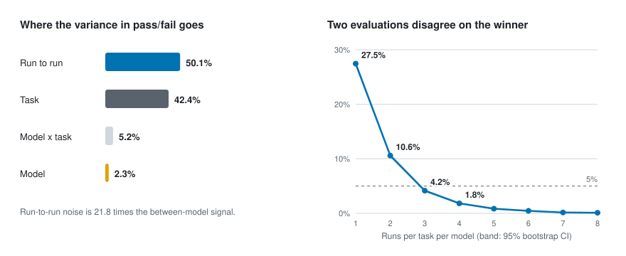

# agent-run-reliability

How many independent runs does an agent evaluation need before a score, or a
ranking between two models, means anything?

The study treats one agent run as a psychometric measurement occasion. Two
models are run repeatedly on the same fixed battery of tasks, and the observed
variance in pass/fail is decomposed into the part that belongs to the model,
the part that belongs to the task, the part that belongs to the pairing of the
two, and the part that is left over between runs of the same model on the same
task. The leftover part is what a single-run leaderboard reports as signal.



`REPORT.md` holds the findings, and the write-up is at
[abhaymettu.com/research/agent-run-reliability](https://www.abhaymettu.com/research/agent-run-reliability/).
This file describes the apparatus. The figure is drawn from
`results/analysis.json` by `python3 analysis/readme_figure.py`.

## Design

- 24 tasks, four categories of six: `xform_*` (data reshaping), `codefix_*`
  (repair a failing program), `chore_*` (filesystem work), `arith_*`
  (multi-step numeric derivation).
- 2 models, `sonnet` and `haiku`, invoked as separate `claude -p` subprocesses.
- 8 independent runs per model per task.
- Fully crossed and balanced: 24 x 2 x 8 = 384 runs.
- A turn budget of 3, passed to each subject as `--max-turns` and recorded per
  run as `max_turns_cap`. The budget is what sets the difficulty: under an
  unconstrained budget both models pass this battery about 97% of the time,
  which leaves nothing to decompose. `docs/DIFFICULTY.md` and
  `results/calibration/` cover how the number was chosen and what it costs in
  interpretation.

Each run is scored pass/fail by a checker that inspects the end state of the
working directory. No model judges another model's output.

## A task

Five files in `tasks/<task_id>/`:

| file | role |
| --- | --- |
| `gen.py` | builds the task data from a fixed seed; shared by setup and checker |
| `setup.py` | writes the starting working directory, byte-identical every time |
| `prompt.txt` | the whole of what the subject is told |
| `check.py` | recomputes ground truth and scores the end state, exit 0 = pass |
| `solution.py` | reference solution, used only for validation |

`docs/TASK_CONTRACT.md` is the binding version of this. Two properties matter
most. Ground truth is never stored anywhere the subject can read; `check.py`
re-derives it from the same seed. And `solution.py` exists so the validator can
assert both directions: a setup-only working directory must fail the checker,
and setup plus reference solution must pass it. The first catches a checker
that passes everything, the second catches a task nothing can solve.

## Running it

Validate the battery, including the assertion that a checker tolerates the
hidden directory the host's session hooks write into every working directory:

```
python3 tools/validate_tasks.py
```

Check that the analysis recovers variance components it was given:

```
python3 analysis/selftest.py
```

Run the grid. It appends one JSON object per run to `results/runs.jsonl`,
flushed and fsynced, and skips cells already present on restart:

```
python3 harness/run_grid.py --models sonnet,haiku --runs 8 --concurrency 4 \
    --timeout 300 --max-turns 3
```

The queue is ordered run-index-major, so every cell gets its first run before
any cell gets its second. An interrupted grid therefore leaves a balanced
design at whatever run count it reached.

Analyse:

```
python3 analysis/analyze.py --runs results/runs.jsonl --out analysis/results.json
```

Python 3 standard library only, harness and analysis alike. Means, variances,
Pearson and Spearman correlation, percentiles, the random-effects ANOVA and the
cluster bootstrap are all written out in `analysis/analyze.py`.

## Layout

```
tasks/          24 task directories
harness/        run_grid.py, the subprocess runner
analysis/       analyze.py, selftest.py, readme_figure.py, results.json
tools/          validate_tasks.py, difficulty_report.py
docs/           TASK_CONTRACT.md, RUN_SCHEMA.md, DIFFICULTY.md
results/        the grid, and every dataset that did not become the grid
```

`docs/RUN_SCHEMA.md` documents the fifteen fields of a run record.

Four earlier datasets are kept rather than deleted, because what they measure
is part of the finding: `results/battery_v1/` is the first battery, which ran
to completion and landed at 0.97 pooled; `results/pilot_v2/` is the second
battery's calibration pilot, which landed at 0.97 as well; `results/
calibration/` is the turn-budget sweep that followed; and `results/discarded/`
is a pilot thrown away because of an environment defect, with the reason.
The v1 battery itself is at the tag `battery-v1`.
